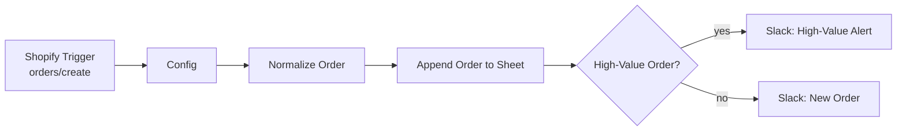
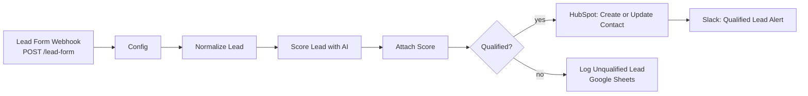

# n8n Workflows

Two importable [n8n](https://n8n.io) workflow templates for common e-commerce and lead handling automations. Both are built with standard n8n nodes, contain no credentials or secrets, and keep every value you need to change in a single **Config** node.

| Workflow | File |
| --- | --- |
| Shopify order to Slack and Google Sheets | `shopify-order-to-slack-and-sheets.json` |
| Lead form to CRM with AI qualification | `lead-form-to-crm-with-ai-qualification.json` |

## How these are built

- **One Config node per workflow.** Channels, spreadsheet IDs and thresholds live in one place instead of being scattered across nodes.
- **Normalize early.** A dedicated Edit Fields node flattens the incoming payload into clean, named fields, so every later node reads simple values.
- **No secrets in the file.** Credentials are referenced by placeholder names only. You attach your own after import.
- **Defensive expressions.** Missing fields fall back to safe defaults, and malformed AI output is treated as "not qualified" rather than breaking the run.
- **Documented in place.** Each workflow has a sticky note with a setup checklist, and key nodes carry notes explaining why they exist.

## 1. Shopify order to Slack and Google Sheets

Every new Shopify order is logged to a Google Sheet and announced in Slack. Orders at or above a configurable total are routed to a separate channel with a more detailed alert.



**What each step does**

1. **Shopify Trigger** listens for the `orders/create` webhook topic.
2. **Config** holds the spreadsheet ID, sheet name, Slack channels and high-value threshold.
3. **Normalize Order** reduces the order to: `order_number`, `order_id`, `created_at`, `customer_name`, `customer_email`, `total`, `currency`, `item_count`, `items`, `financial_status`, `shipping_country`, `is_high_value`.
4. **Append Order to Sheet** adds one row per order. It auto-maps fields to columns, so the sheet's header row must use the field names above.
5. **High-Value Order?** branches on `is_high_value`.
6. **Slack** posts either a detailed alert or a one-line notification.

**Required credentials**

| Node | Credential type | Notes |
| --- | --- | --- |
| Shopify Trigger | Shopify Access Token API | Custom app with the `read_orders` scope |
| Append Order to Sheet | Google Sheets OAuth2 API | Access to the target spreadsheet |
| Slack nodes | Slack API (bot token) | `chat:write` scope. Invite the bot to both channels |

## 2. Lead form to CRM with AI qualification

A webhook receives a lead form submission, an OpenAI model scores the lead and returns structured JSON, and the workflow routes it. Qualified leads become HubSpot contacts and trigger a Slack alert. Everything else is logged to a Google Sheet for review.



**What each step does**

1. **Lead Form Webhook** accepts a `POST` with a JSON body and responds immediately, so the form never waits on the AI call. Header Auth rejects requests that do not carry your shared secret.
2. **Config** holds the minimum score, Slack channel and spreadsheet details.
3. **Normalize Lead** trims fields, lowercases the email, splits the name and caps the message length.
4. **Score Lead with AI** asks the model for a JSON object: `score` (0 to 100), `qualified`, `reason`, `suggested_next_step`. The prompt tells the model to treat the lead's text as data, not instructions.
5. **Attach Score** merges the verdict with the lead. A lead counts as qualified only when the model says so and the score meets your threshold.
6. **Qualified?** branches on that result.
7. **HubSpot** upserts the contact by email (no duplicates), then **Slack** posts the score, reason and next step.
8. **Log Unqualified Lead** appends the lead and the AI's reasoning to a sheet.

**Expected request body**

```json
{
  "name": "Jane Doe",
  "email": "jane@example.com",
  "company": "Example Co",
  "phone": "+1 555 0100",
  "message": "We need help migrating our store before the end of the quarter.",
  "source": "contact-page"
}
```

**Required credentials**

| Node | Credential type | Notes |
| --- | --- | --- |
| Lead Form Webhook | Header Auth | A header name and secret value that your form sends with each request |
| Score Lead with AI | OpenAI API | Any chat model that supports JSON output. Default is `gpt-4o-mini` |
| HubSpot | HubSpot App Token | Private app with contact read and write scopes |
| Slack | Slack API (bot token) | `chat:write` scope |
| Log Unqualified Lead | Google Sheets OAuth2 API | Header row: `received_at`, `full_name`, `first_name`, `last_name`, `email`, `company`, `phone`, `source`, `message`, `score`, `qualified`, `reason`, `suggested_next_step` |

## Import steps

1. Download the `.json` file you want (or copy its raw content).
2. In n8n, go to **Workflows**, create a new workflow, open the **...** menu in the top right and choose **Import from file** (or paste the JSON straight onto the canvas).
3. Open each node marked with a credential warning and select or create your own credential.
4. Open the **Config** node and replace the placeholder values.
5. Run the workflow once with test data: use **Test workflow** and place a test order or send a sample request to the test webhook URL.
6. When the output looks right, toggle the workflow to **Active**.

Built against n8n 1.x node versions. If your instance is newer, n8n may offer to upgrade individual nodes. The workflow logic stays the same.

## How to adapt

- **Different threshold or channels:** change the values in **Config**. No other node needs editing.
- **Different sheet columns:** rename or remove fields in the Normalize node and update the sheet's header row to match.
- **Different qualification criteria:** edit the "Ideal customer" paragraph in the system prompt of **Score Lead with AI**. Keep the JSON keys unchanged so the downstream nodes still work.
- **Another CRM:** replace the HubSpot node with Pipedrive, Salesforce, Zoho or an HTTP Request node. The lead fields arrive already normalized.
- **Another chat tool:** swap the Slack nodes for Microsoft Teams, Discord or email.
- **Environment variables:** on self-hosted n8n you can replace Config values with expressions such as `{{ $env.SLACK_CHANNEL }}`, if environment access is enabled on your instance.
- **Error handling:** for production use, add an Error Trigger workflow that notifies you when an execution fails.

## Good to know

- AI scoring is a triage aid, not a final decision. The unqualified log exists so a person can review what the model set aside.
- Lead data is sent to OpenAI for scoring. Make sure that fits your privacy policy and any data processing agreements.
- The Shopify `orders/create` payload only includes customer details that your app's access level allows.

## License

Source-available, not open source. You may read and evaluate this code, but commercial or production use requires a written licence from Usama Afzall. See `LICENSE` and https://usama.websiteprism.com/contact.

## Need this customized?

These templates are a starting point. If you want them adapted to your stack, extended with more steps, or built into a larger automation, get in touch.

**Usama Afzal**, Shopify developer and AI automation builder, founder of [Website Prism](https://websiteprism.com)

- Contact: https://usama.websiteprism.com/contact
- Portfolio: https://usama.websiteprism.com
- Email: usama@websiteprism.com
